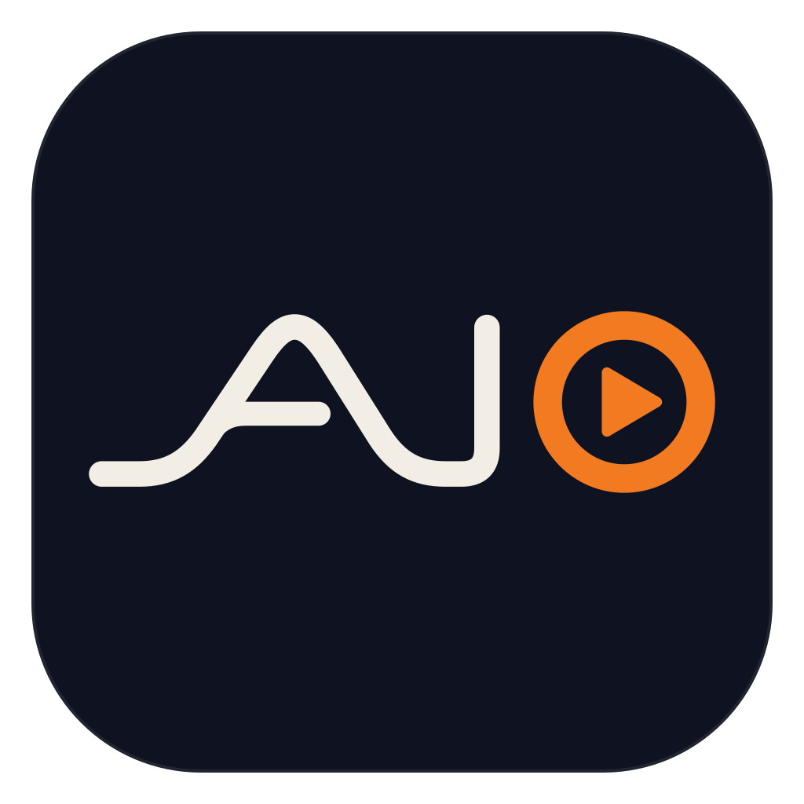
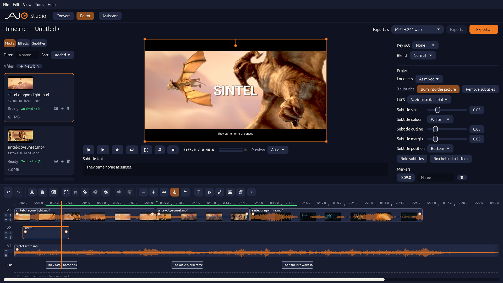
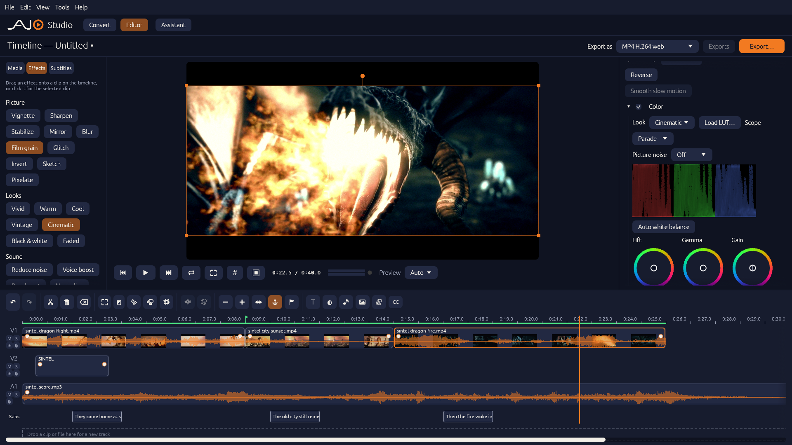
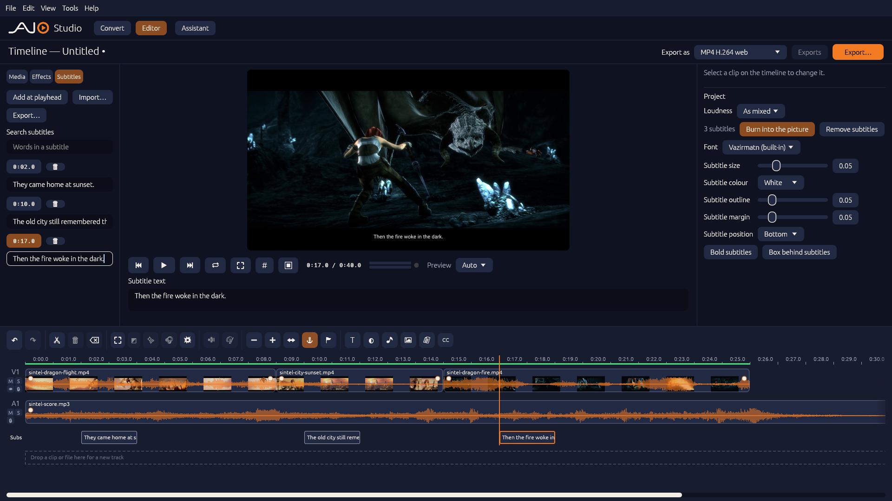
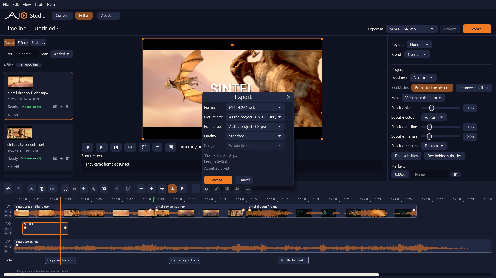
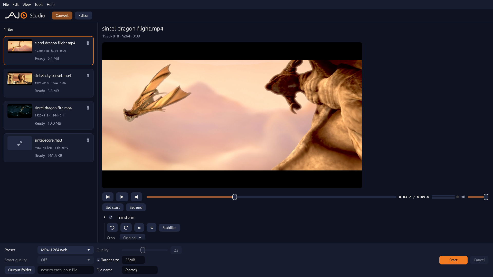

<p align="center"></p>

<h1 align="center">Aio Studio for Linux</h1>

<p align="center">
  <b>Edit, convert and compress video and audio.</b><br>
  A timeline editor, a colour grader and a converter in one small native app,<br>
  with its own FFmpeg inside. Free on GNU/Linux. Forever.
</p>

<p align="center">
  <a href="https://github.com/ChartAndChill/Aio-Studio/raw/main/downloads/aio-studio_1.3.0_amd64.deb"><b>⬇ Debian / Ubuntu (.deb, x86_64, 47 MB)</b></a>
  &nbsp;·&nbsp;
  <a href="https://github.com/ChartAndChill/Aio-Studio/raw/main/downloads/aio-studio_1.3.0_x86_64.AppImage"><b>⬇ Any other Linux (AppImage, x86_64, 40 MB)</b></a>
</p>



---

## Why is it free on Linux?

Because you already paid.

You paid in `.conf` files at two in the morning. You paid every time you
explained to a relative that "Linux" is not a virus. You paid by reading a man
page all the way to the end, on purpose. Aio Studio was written on GNU/Linux,
by one person, with a great deal of respect for the free software community,
and the Linux build is our thank-you: **free of charge, for any purpose,
including commercial work, on as many machines as you like, for as long as
the app exists.** No trial, no account, no watermark, no "Pro" button that
opens a shop.

On **Windows and macOS** Aio Studio is paid. Think of it as the
*walled-garden tax*: you chose a system whose source you cannot read, so you
are used to paying for things you cannot read. Someone has to keep the lights
on, and it may as well be the people who also pay for their mouse to have a
logo on it.

And to our friends from the GNU project, before you open an issue: yes, we
know. This is *gratis*, not *libre*. The app's own source stays closed. The
FFmpeg inside it, however, **is** free software under the GPL, and its complete
source sits right here, next to the installer
([see below](#licence-the-short-version)).

| | GNU/Linux | Windows | macOS |
|---|---|---|---|
| Price | **Free, forever** | Paid | Paid |
| Use at work, for money | ✅ | ✅ (with a licence) | ✅ (with a licence) |
| Give copies to friends | ✅ the unchanged `.deb` or AppImage | ❌ | ❌ |
| App source code | closed | closed | closed |
| Bundled FFmpeg | GPL-2.0-or-later, with x264 and x265 | LGPL-2.1-or-later | LGPL-2.1-or-later |
| FFmpeg source | ✅ in this repo | on request | on request |
| Moral high ground | ✅ | ❌ | ❌ (but it looks nice) |

---

## Screenshots

The film in the viewer is **[Sintel](https://durian.blender.org/)**, the
Blender Foundation's open movie, made entirely in Blender
([credits](#credits)).

**Colour.** A *Cinematic* look and film grain on the fire shot, with the RGB
parade, and lift, gamma and gain wheels.


**Subtitles.** Every subtitle in a list you can search and type into, on its
own lane of the timeline, burnt into the picture or kept as a track.


**Export.** Format, size, frame rate, quality and range, with the length and
an estimate of the file size before you press Save.


**Convert.** Drop in files, pick a preset, or ask for a size ("25 MB for
Discord"), and press Start.


---

## Install

**Debian 12+, Ubuntu 22.04+, Linux Mint 21+, Pop!_OS, elementary and other
Debian-based systems (x86_64):**

1. Download [`aio-studio_1.3.0_amd64.deb`](https://github.com/ChartAndChill/Aio-Studio/raw/main/downloads/aio-studio_1.3.0_amd64.deb).
2. Install it:

   ```bash
   sudo apt install ./aio-studio_1.3.0_amd64.deb
   ```

3. Open **Aio Studio** from your applications menu, or run `aio-studio`.
   The command-line tool is `aio`.

To remove it: `sudo apt remove aio-studio`.

The package puts `aio-studio` and `aio` in `/usr/bin` and its FFmpeg in
`/usr/lib/aio-studio/ffmpeg/`. It does not touch, need or replace a system
FFmpeg.

**Fedora, Arch, openSUSE and any other Linux (x86_64):**

1. Download [`aio-studio_1.3.0_x86_64.AppImage`](https://github.com/ChartAndChill/Aio-Studio/raw/main/downloads/aio-studio_1.3.0_x86_64.AppImage).
2. Make it runnable and run it:

   ```bash
   chmod +x aio-studio_1.3.0_x86_64.AppImage
   ```

   ```bash
   ./aio-studio_1.3.0_x86_64.AppImage
   ```

   On a system without FUSE, add `--appimage-extract-and-run`.

To check a download first, put [`SHA256SUMS`](SHA256SUMS) next to it and run:

```bash
sha256sum -c SHA256SUMS --ignore-missing
```

Both files come out of the project's release pipeline, which builds them on
Ubuntu 22.04, installs the `.deb` there and runs the installed `aio` before
it lets them out.

**Requirements:** a 64-bit x86 PC, glibc 2.35 or newer, X11 or Wayland, and
OpenGL (any Mesa, NVIDIA or AMD driver from the last ten years). A
graphics card is optional: NVIDIA cards encode with NVENC, Intel and AMD
cards with VAAPI (new in 1.2.0, through your system's own libva and driver),
and auto captions run on any card with a Vulkan driver. The app tests the
card's encoders itself and does on the CPU whatever the card cannot.

---

## What it does

### Editor
- **Timeline** with video, overlay and audio tracks; drag, trim, split,
  ripple, snap, multi-select, copy and paste, markers, and undo for
  everything.
- **Viewer** that plays the finished picture with its sound, frame by frame
  (J, K, L, arrows), in a loop, or full screen.
- **Transform and keyframes**: position, size, rotation and opacity, with
  ease in and out; masks, blend modes and green-screen keying.
- **Speed**: any speed from 0.1× to 10×, speed ramps, reverse, freeze frame
  and smooth slow motion.
- **Titles**: any font, size, colour, outline, shadow and box, with animated
  entrances.
- **Subtitles**: a lane on the timeline, a searchable list, import and
  export of `.srt`, `.vtt` and `.ass`, and Persian and Arabic text shaped
  correctly.
- **Auto captions**: speech to subtitles with whisper.cpp, on your own
  computer. Nothing is uploaded.
- **Animated captions**: burned subtitles that light up word by word as
  they are said (karaoke), or pop one word at a time, in a colour you pick.
- **Edit by the words**: cut a sentence out of the video from its subtitle,
  mark single words and cut just those, or remove every "um" and "uh" in
  one go (and one Undo).
- **Sound**: audio tracks, a loudness meter, noise reduction, a one-click
  voice leveller, ducking music under a voice, voice-over recording, and
  loudness normalisation to −14 or −16 LUFS.
- **Effects**: vignette, sharpen, stabilise, blur, film grain, glitch,
  pixelate, and transitions between shots.

### Colour
- Looks (Vivid, Warm, Cool, Vintage, Cinematic, Black & white, Faded) and
  `.cube` LUTs.
- Lift, gamma and gain wheels, tone curves, temperature, hue, contrast,
  saturation and vibrance.
- Scopes: histogram, waveform, RGB parade and vectorscope.
- Auto white balance, and *Match previous clip* to make two shots agree.

### Converter
- MP4, MKV, WebM, MOV, AVI, TS, GIF, MP3, M4A, Opus, OGG, FLAC and WAV, with
  H.264, HEVC, AV1, VP9, VP8, ProRes, AAC, Opus, MP3, FLAC, ALAC, PCM and
  AC-3.
- **Target size**: "make it 10 MB" in two passes, so the file comes out close
  to the size you asked for.
- **Smart quality**: the smallest bitrate that keeps the quality you chose,
  measured on a few seconds of each file.
- A remux, not a re-encode, when a file is already in the right format; many
  files at once.

### AI, if you want it
- **Assistant** in the editor: ask for an edit in your own words ("take the
  pauses out", "make it vertical for Reels") with Claude, or any
  OpenAI-compatible model, including one on your own machine. Off unless you
  give it a key.
- **`aio mcp`** serves the app's tools over the Model Context Protocol, so
  Claude Code, Claude Desktop or Codex can probe, cut, grade and render your
  media through Aio Studio.

### Command line

```bash
aio convert holiday.mov --to "MP4 H.264 web"
aio compress gameplay.mp4 --target-size 10MB
aio convert *.wav --to mp3 -o converted/ --jobs 4
aio convert clip.mp4 --to mp4 --look cinematic --lut dlog-to-rec709.cube
aio captions talk.mp4 --language fa
aio render edit.aio.json --to webm --short-side 720
aio analyze interview.mp4
aio mcp
```

`aio --help` lists everything.

---

## Under the hood

| | |
|---|---|
| Language | Rust, in four crates: the media core, the GUI, the CLI and the AI layer |
| GUI | [egui](https://github.com/emilk/egui) with OpenGL, drawn directly: no Electron, no web view, no Qt or GTK |
| Size | the app is one ~16 MB binary; with FFmpeg the `.deb` is 47 MB and the AppImage 40 MB |
| Media engine | FFmpeg 8.1.3, built in CI for this app and run as a separate program |
| FFmpeg codecs | x264, x265, SVT-AV1, libvpx, Opus, LAME, plus libass, FreeType, HarfBuzz and FriBidi for text |
| GPU | NVENC for H.264, HEVC and AV1 on NVIDIA; VAAPI for H.264 and HEVC on Intel and AMD; whisper.cpp on Vulkan for auto captions |
| Speech | whisper.cpp inside FFmpeg's `whisper` filter; models (tiny to large-v3-turbo) are fetched on first use and checked by SHA-256 |
| Preview | frames decoded by FFmpeg and drawn by the GUI; the same filter graph as the export, so what you see is what you get |
| Projects | plain JSON (`.aio.json`) with a published JSON Schema (`aio schema`), autosaved, with crash recovery |
| Files | settings in `~/.config/aio-studio`, speech models in `~/.cache/aio-studio/models` |
| Network | none, unless you use the assistant or download a speech model |
| Telemetry | none |

---

## Licence, the short version

- **Aio Studio** (the `aio-studio` app and the `aio` command) is © 2026
  AIO Technologies, under its own licence: [`LICENSE`](LICENSE). On Linux it
  is free of charge for any use, and you may pass on the unchanged `.deb` and
  AppImage. It is not open source, and you may not sell it or change it.
- **FFmpeg**, inside the package, is a separate program under the **GNU
  General Public License version 2 or later**, because it is built with
  `--enable-gpl`, x264 and x265. Its complete corresponding source, with every
  library it is built with and the scripts that build them, is
  [`downloads/aio-studio-sources-v1.3.0.tar`](downloads/aio-studio-sources-v1.3.0.tar).
- Every installed copy has the full texts in
  `/usr/lib/aio-studio/licenses/`, and **Help ▸ Licences** in the app shows
  them.

---

## Credits

The screenshots show frames from **Sintel**, © copyright Blender Foundation |
[durian.blender.org](https://durian.blender.org/), licensed under
[Creative Commons Attribution 3.0](https://creativecommons.org/licenses/by/3.0/).
The clips were cut from the 1080p release and shown unchanged except where a
screenshot shows the app's own grade or title on them. Sintel is not
affiliated with Aio Studio.

Titles and subtitles use the bundled Vazirmatn font, © The Vazirmatn Project
Authors, under the SIL Open Font License 1.1.

---

## Contact

Made by one person at [AIO Technologies](https://aiotech.si).
Write to **info@aiotech.si**, or on Telegram to **@AioTechnologies**, for
bugs, the Windows and macOS versions, or a licence for your company.
